<p align="center">
  
</p>

**Baton lets you use several Claude Code accounts as if they were one.** When an account hits its 5-hour or weekly
limit, Baton moves your conversation to the next account and carries on where it stopped, instead of making you start
over.

- You add the accounts. Each one signs in through Claude Code's own login.
- Baton keeps track of every account's usage and picks the best one for new work.
- When one runs out, the same conversation resumes on another.

Needs Node 24 or newer. Built and tested on Windows 11; macOS and Linux should work the same way but have not been
tested yet. Baton is an independent project and is not affiliated with Anthropic (see
[Good to know](#good-to-know)).

## Quick start

```sh
git clone https://github.com/ntanis-dev/baton.git
cd baton
npm install
npm link            # puts `baton` on your PATH
```

Add your accounts and sign each one in. A name can be anything: an email, a few words, a label you like.

```sh
baton account add "Work account"
baton login "Work account"          # Claude Code's own sign-in, in your terminal
baton account add "Spare" --last-resort
baton login "Spare"
```

Let Claude Code report its usage to Baton, then check that everything is wired up:

```sh
baton install --dry-run             # see what it would change in ~/.claude (add --diff for every line)
baton install
baton doctor
```

Then work as usual:

```sh
baton start                         # Claude Code on the best account, moved on when one runs out
baton                               # or open the menu
```

## Everyday use

| Command                    | What it does                                                                              |
| -------------------------- | ----------------------------------------------------------------------------------------- |
| `baton`                    | Opens the menu (prints the status when there is no terminal)                              |
| `baton start [args]`       | Starts Claude Code on the best account. Takes Claude's own arguments: `--model opus` ...  |
| `baton status`             | Every account at a glance, and where new work goes                                        |
| `baton usage [--refresh]`  | Each account's windows, where every reading came from; `--refresh` asks Claude Code now   |
| `baton stats`              | The last 7 days: usage, moves, refusals, weekly allowance left unused                     |
| `baton policy`             | Shows the settings; change one with `baton policy --mode order`, `--start-reserve 25` ... |
| `baton hop [--to account]` | Moves a running conversation at the end of its turn (inside Claude: `/hop [account]`)     |
| `baton account ...`        | `list`, `add`, `rename`, `remove`, `order`, `move`, `set` (marks and thresholds)          |
| `baton doctor`             | Checks Claude Code, every profile and the install                                         |
| `baton conflicts`          | Shared files changed in two places at once, with the backups kept                         |

`baton help <command>` shows a command's options, and `--json` prints data instead of the screen where that makes
sense. `baton start` stays out of the way:
Ctrl+C, Esc and `/exit` all go to Claude Code. Running `claude` directly still works; Baton just does not move it.

Accounts have an order and a mark: **preferred**, **normal** or **last resort** (used only when every other account is
blocked). Each can have its own thresholds, by default 90% of the 5-hour window and 95% of the weekly one.

```sh
baton account order "Spare" "Work account"            # priority order
baton account set "Work account" --mark preferred
baton account set "Spare" --five-hour 85 --weekly 90  # or "default"
baton account rename "Spare" spare@example.com        # only the label changes
baton account remove spare@example.com                # never the last one
```

## When an account runs out

Baton watches each turn end and decides what to do:

- **An account hit its limit.** If it is the 5-hour limit and it resets within 20 minutes, Claude Code waits in
  place. Otherwise Baton closes `claude`, prints one line saying which account reached what and where the
  conversation goes next, and counts down 10 seconds. Enter goes now, any other key stays, Ctrl+C quits. Then the same
  conversation resumes on the next account, with a note telling Claude it was moved and why.
- **An account is about to run out.** Baton estimates what a turn costs and moves between turns when the next one would
  not fit, so you never meet a refusal halfway through. It never moves while subagents or a workflow are running.
- **After a compaction**, the context is small and moving is cheap, so Baton rebalances if the account would run out
  within the hour and another one has clearly more room.
- **Every account is blocked.** Baton shows who is back first, waits with a live countdown, and resumes there.
- **You ask.** `/hop [account]` inside Claude Code, or `baton hop` from another terminal.

Which account gets the work? In the default `smart` mode: a preferred account with at least 20% of its 5-hour window
left; otherwise the normal account whose weekly allowance is most at risk of going unused; last-resort accounts only
when nothing else is open. In `order` mode it is simply the first open account in your order.

## The menu

`baton` opens a full-screen app (at least 100 × 28 characters): accounts on the left, details on the right.

- The **overview** shows the next account, usage meters, live sessions and today's moves.
- Each **account** has an Actions menu: rename, mode, thresholds, refresh, sign-in, order and delete. Each action's
  shortcut key is shown next to it.
- **Policy** and **Stats** have their own views. Removing an account or changing the policy asks you to confirm.

| Key                          | Action                                                   |
| ---------------------------- | -------------------------------------------------------- |
| Click, `↑` `↓`, `Home` `End` | Select an item and show it                               |
| `Enter`                      | Open the Actions menu of the selected account or session |
| `/`                          | Search                                                   |
| `PgUp` `PgDn`, mouse wheel   | Scroll the details                                       |
| `q` or `Ctrl+C`              | Quit                                                     |

Set `NO_COLOR` to drop the colors, `BATON_GLYPHS=plain` for the classic Windows console's glyphs, and
`BATON_MOUSE=off` to leave the mouse alone. The other commands print in the same look, and as plain text when piped.

## Safe by design

- **Baton never touches a credential.** It does not read, copy, store or send `.credentials.json` or any token. Each
  account signs in with `claude auth login` inside its own profile; `baton login` just runs that for you.
- **No proxy.** Claude Code talks to Anthropic exactly as it always does. Baton only decides which profile a `claude`
  process runs under, and resumes conversations under another one.
- **Your default Claude Code account stays yours.** Baton uses only the accounts you add, each a profile of its own
  in `~/.baton/accounts/<id>`. Its hooks and status line do nothing in plain `claude`.
- **`~/.claude` changes only through `baton install`**, which shows what it will do, keeps a backup, and is undone by
  `baton uninstall`.

`baton install` adds three things to `~/.claude`:

- **A status line.** It records each account's usage. If you already had a status line, yours still runs, unchanged,
  right after. If you had none, Baton shows its own: `╺━╸ Work · 5h 42% · week 63% ┃ 5h ▂▇▅ 31% · week ▃▅▇ 58%`.
  That is the account and its two windows, then one little bar per account (the fuller, the taller, red when it is
  over its threshold) and the average of them all. Your current account's bar is underlined and always live; the
  other accounts' bars come from their last recorded usage, so they can lag a little.
  If you keep your own status line, Baton shows nothing of its own there. To add Baton's usage after yours, on the same
  line and only as far as the terminal is wide, run `baton policy --status-line-usage true` (or turn on Bar usage in
  the menu's Policy view). `false` turns it off again.
- **Hooks** for `SessionStart`, `UserPromptSubmit`, `Stop`, `StopFailure` and `SessionEnd`. They run in a fraction of a
  second, never block, and never fail a session. Your own hooks stay.
- **The `/hop` command** (skipped if you have your own `hop.md`).

The previous files are copied to `~/.baton/backups/<time>/`. `baton uninstall` removes exactly Baton's entries and puts
your old status line back. To remove Baton completely, uninstall and then delete `~/.baton/` (keep `accounts/` if you
still want those sign-ins).

## More detail

<details>
<summary><strong>Accounts and profiles</strong></summary>

Every account is a Claude Code profile in `~/.baton/accounts/<id>`. The **id** is made from the name when you add the
account (lowercase letters, digits and `-`, so `jane@example.com` becomes `jane-example-com`) and never changes.
The **name** is only a label: any text up to 120 characters, unique ignoring case, and renaming it moves nothing.
Commands take an account by name or id (put `--` before a name that starts with `-`).

A profile shares everything but the sign-in with `~/.claude`, so conversations and memory are the same whichever
account runs them:

- Folders such as `projects/` (transcripts, memory), `skills/`, `agents/`, `commands/`, `plugins/`, `plans/`, `tasks/`
  and `rules/` are junctions (Windows) or symbolic links.
- `settings.json`, `CLAUDE.md` and `keybindings.json` are symbolic links where the OS allows it (on Windows, with
  Developer Mode, which also shares `history.jsonl`). Otherwise they are two-way copies: a change made in a profile
  (say `/config` under one account) is copied back to `~/.claude`, after a timestamped backup, and on to the other
  profiles. If the same file changed in two places, `~/.claude`'s wins, the other is backed up, and `baton conflicts`
  shows it.
- The profile's `.claude.json` is its own, because it holds that account's identity. Baton seeds it with your
  onboarding state, trusted folders and MCP servers (never identity), so a new profile starts without first-run
  prompts.

</details>

<details>
<summary><strong>How usage is checked, also when nothing is running</strong></summary>

The status line only reports an account's usage while a session runs on it. So while any Baton instance runs (the menu
or a `baton start`), one of them asks every signed-in account for its plan usage: when it starts if the last check is
old, every 30 minutes (`baton policy --usage-poll <minutes>`, `0` for only on request), after an account is added,
renamed or signed in, and when you ask (`r` in the menu, or `baton usage --refresh`).

- **No background service.** When no Baton instance runs, nothing polls, and no Baton process outlives the last one.
  Several instances share the work through a lease in `~/.baton/poll/`: one polls, and another takes over within
  seconds if it exits.
- **Quiet.** In a `baton start` window the check is silent and runs at low priority. It runs Claude Code's `/usage`
  under the account's profile with no settings, hooks, tools or MCP servers loaded, and ends it after 60 seconds.
- **Honest readings.** Each one says where it came from ("polled 12m ago", "from session 2m ago"). A model's own weekly
  limit (Fable's, for example) is shown with the account and counts when it is the fuller one. If the usage endpoint is
  rate limited, Baton waits as long as it says (otherwise 5 minutes, doubling up to 2 hours).

`baton status` says which instance polls, or "no baton running".

</details>

<details>
<summary><strong>Where Baton keeps its files</strong></summary>

```
~/.baton/config.json              accounts in order (id, name, mark, thresholds), policy
~/.baton/accounts/<id>/           the profiles (CLAUDE_CONFIG_DIR)
~/.baton/usage/<id>.json          latest reading per account and window, with its source
~/.baton/poll/                    the usage check's state, lease and requests
~/.baton/probe/                   the folder usage checks run in (no transcripts kept)
~/.baton/rejected/                refusals per account and window
~/.baton/sessions/<id>/           per-conversation state from the hooks and status line
~/.baton/history/                 append-only readings and events (moves, refusals, sessions)
~/.baton/install.json, backups/   what baton install did, and backups of two-way copies
~/.baton/copies.json, conflicts.json   what was last copied into each profile, and copy conflicts
```

</details>

## Good to know

Baton is an independent, community project. It is **not affiliated with, endorsed by, or sponsored by Anthropic**.
"Claude" and "Claude Code" are trademarks of Anthropic, and Baton uses those names only to say what it works with.

Baton works with the Claude accounts you sign in yourself, through Claude Code's own login, and the real, unmodified
`claude` does all the talking to Anthropic. Your accounts and your use of Claude Code stay covered by Anthropic's own
terms: the [Consumer Terms](https://www.anthropic.com/legal/consumer-terms) for Free, Pro and Max, and the
[Commercial Terms](https://www.anthropic.com/legal/commercial-terms) for Team, Enterprise and the API. Baton does not
change your plan or its limits. It just helps you keep track of your usage and carry a conversation on.

Those terms are Anthropic's to set and they can change, so it is worth a quick read, and how you use your accounts is
up to you. The usage numbers Baton shows come from Claude Code and can be a little behind or differ from what Anthropic
shows. Baton is provided as is, without warranty.

## Development

```sh
npm run check   # syntax
npm run lint    # prettier
npm test        # deterministic: a fake claude, temporary homes under .cache/, no model calls
npm run demo    # interactive UI preview with fixture accounts; no real profiles or sign-ins
```

The runtime dependencies are pinned exactly: Ink and React for the menu, and the Claude Agent SDK 0.3.296 for the
usage check. The repository's `.npmrc` keeps npm from downloading the SDK's bundled Claude Code binaries; Baton runs
your installed `claude`.

## License and security

MIT, see [LICENSE](LICENSE). To report a vulnerability, please use GitHub's private vulnerability reporting, as
described in [SECURITY.md](SECURITY.md).
