<p align="center">
  
</p>

**Baton lets you use several Claude Code accounts as if they were one.** When an account hits its 5-hour or weekly
limit, Baton moves your conversation to the next account and carries on where it stopped, instead of making you start
over.

- You add the accounts. Each one signs in through Claude Code's own login.
- Baton keeps track of every account's usage and picks the best one for new work.
- When one runs out, the same conversation resumes on another.

Written in Rust: one small executable, no runtime to install. Built and tested on Windows 11; macOS and Linux should
work the same way but have not been tested yet. Baton is an independent project and is not affiliated with Anthropic
(see [Good to know](#good-to-know)).

## Quick start

You need [Rust](https://rustup.rs); the repository's `rust-toolchain.toml` picks the version.

```sh
git clone https://github.com/ntanis-dev/baton.git
cd baton
cargo install --locked --path crates/cli   # puts `baton` on your PATH
```

Add your accounts and sign each one in. A name can be anything: an email, a few words, a label you like.

```sh
baton account add "Work account"
baton login "Work account"          # Claude Code's own sign-in, in your terminal
baton account add "Spare" --last-resort
baton login "Spare"
```

Let Claude Code report its usage to Baton, then check that everything is wired up:

```sh
baton install --dry-run             # see what it would change in ~/.claude (add --diff for every line)
baton install
baton doctor
```

Then work as usual:

```sh
baton                               # Claude Code on the best account, moved on when one runs out
baton view                          # or open the menu
```

## Everyday use

| Command                    | What it does                                                                              |
| -------------------------- | ----------------------------------------------------------------------------------------- |
| `baton [args]`             | Starts Claude Code on the best account. Takes Claude's own arguments: `--model opus` ...  |
| `baton view`               | Opens the menu: accounts, sessions, policy and stats, live                                |
| `baton status`             | Every account at a glance, and where new work goes                                        |
| `baton usage [--refresh]`  | Each account's windows, where every reading came from; `--refresh` asks Claude Code now   |
| `baton stats`              | The last 7 days: usage, moves, refusals, weekly allowance left unused                     |
| `baton policy`             | Shows the settings; change one with `baton policy --mode order`, `--start-reserve 25` ... |
| `baton hop [--to account]` | Moves a running conversation at the end of its turn (inside Claude: `/hop [account]`)     |
| `baton account ...`        | `list`, `add`, `rename`, `remove`, `order`, `move`, `set` (marks and thresholds)          |
| `baton sync`               | Brings every account's setup in step now, and lists what the accounts differ on           |
| `baton doctor`             | Checks Claude Code, every profile, the install, the Ferry registration and Ferry's agent  |
| `baton conflicts`          | Shared files changed in two places at once, with the backups kept                         |

`baton help <command>` shows a command's options, and `--json` prints data instead of the screen where that makes
sense. To start with a prompt, put `start` first: `baton start "fix the tests"`. `baton` stays out of the way: Ctrl+C,
Esc and `/exit` all go to Claude Code. Running `claude` directly still works; Baton just does not move it.

Accounts have an order and a mark: **preferred**, **normal** or **last resort** (used only when every other account is
blocked). Each can have its own thresholds, by default 90% of the 5-hour window and 95% of the weekly one.

```sh
baton account order "Spare" "Work account"            # priority order
baton account set "Work account" --mark preferred
baton account set "Spare" --five-hour 85 --weekly 90  # or "default"
baton account rename "Spare" spare@example.com        # only the label changes
baton account remove spare@example.com                # never the last one
```

## When an account runs out

Baton watches each turn end and decides what to do:

- **An account hit its limit.** If it is the 5-hour limit and it resets within 20 minutes, Claude Code waits in
  place. Otherwise Baton closes `claude`, prints one line saying which account reached what and where the
  conversation goes next, and counts down 10 seconds. Enter goes now, any other key stays, Ctrl+C quits. Then the same
  conversation resumes on the next account, with a note telling Claude it was moved and why. The note names no
  account.
- **An account is about to run out.** Baton estimates what a turn costs and moves between turns when the next one would
  not fit, so you never meet a refusal halfway through. It never moves while subagents or a workflow are running. The
  estimate is of this conversation alone: what your other sessions on the same account used meanwhile is left out.
- **An account is over its threshold.** It is left at the end of the turn, as soon as another account is open, without
  waiting for a refusal. A key during the countdown keeps the conversation where it is.
- **After a compaction**, the context is small and moving is cheap, so Baton rebalances if the account would run out
  within the hour and another one has clearly more room.
- **Every account is blocked.** Baton shows who is back first, waits with a live countdown, and resumes there.
- **You ask.** `/hop [account]` inside Claude Code, or `baton hop` from another terminal.

Hops that follow one another go on, not back: until a turn has ended well on an account and the conversation has been
there for the minimum stay (30 minutes, `baton policy --min-stay <minutes>`), it is not moved back to an account it
just left while another one is open. Only when it has been through all of them does it return, to the one it left
longest ago. `/hop <account>` still goes exactly where you say.

Which account gets the work? In the default `smart` mode: a preferred account with at least 20% of its 5-hour window
left; otherwise the normal account whose weekly allowance is most at risk of going unused; last-resort accounts only
when nothing else is open. In `order` mode it is simply the first open account in your order.

## One setup, every account

Set Claude Code up once and every account has it. Settings, skills, plugins, agents, commands, output styles, memory
and conversations are the same files for every account, and Baton keeps the rest in step (full sync, on by default):

- **What you set in Claude Code itself.** The theme and other preferences, your MCP servers, and for every folder its
  trust, allowed tools and MCP approvals. Change one under any account and the others have it the next time they are
  used.
- **It follows the conversation.** Add an MCP server on the current account, and when the conversation moves on, it is
  there on the next one.
- **A new account starts with everything** the others have, except the sign-in.
- **Nothing you set is written over silently.** When two accounts changed the same setting in different ways, Baton
  keeps both and asks: at the next `baton` start (press the number of the one to keep) or with `baton sync`.
- **One account cannot take back what you granted.** A folder's trust, an allowed tool or a notice you already answered
  stays on every account when one of them loses it (Claude Code starting its onboarding over, say): that account gets
  it back. It is gone only once no account holds it any more.

What is never shared: who an account is (its sign-in and identity), and Claude Code's own caches and counters.
`~/.claude.json`, plain Claude Code's own file, is only read: what you change there reaches your accounts, never the
other way round.

```sh
baton sync                          # bring every account in step now; lists what the accounts differ on
baton sync take 1 "Work account"    # that account's value for question 1 goes to every account
baton policy --full-sync off        # each account keeps its own; a new one starts from ~/.claude.json
```

To keep one more key of `.claude.json` in step, name it in `~/.baton/config.json`: `"syncKeys": ["diffSidebarOpen"]`
(and `"syncProjectKeys"` for a key of a folder's entry).

## The menu

`baton view` opens a full-screen app (at least 100 × 28 characters): accounts on the left, details on the right.

- The **overview** shows the next account, usage meters, live sessions and today's moves.
- Each **account** has an Actions menu: rename, mode, thresholds, refresh, sign-in, order and delete. Each action's
  shortcut key is shown next to it.
- **Policy** and **Stats** have their own views. Removing an account or changing the policy asks you to confirm.

| Key                          | Action                                                   |
| ---------------------------- | -------------------------------------------------------- |
| Click, `↑` `↓`, `Home` `End` | Select an item and show it                               |
| `Enter`                      | Open the Actions menu of the selected account or session |
| `/`                          | Search                                                   |
| `PgUp` `PgDn`, mouse wheel   | Scroll the details                                       |
| `q` or `Ctrl+C`              | Quit                                                     |

Set `NO_COLOR` to drop the colors, `BATON_GLYPHS=plain` for the classic Windows console's glyphs, and
`BATON_MOUSE=off` to leave the mouse alone. The other commands print in the same look, and as plain text when piped.

## Safe by design

- **Baton never touches a credential.** It does not read, copy, store or send `.credentials.json` or any token. Each
  account signs in with `claude auth login` inside its own profile; `baton login` just runs that for you.
- **No proxy.** Claude Code talks to Anthropic exactly as it always does. Baton only decides which profile a `claude`
  process runs under, and resumes conversations under another one.
- **Your default Claude Code account stays yours.** Baton uses only the accounts you add, each a profile of its own
  in `~/.baton/accounts/<id>`. Its hooks and status line do nothing in plain `claude`.
- **The status line, hooks and `/hop` reach `~/.claude` only through `baton install`**, which shows what it will do,
  keeps a backup, and is undone by `baton uninstall`.
- **One Baton moves a conversation.** The `baton` that started a conversation is the one that moves it. If you
  `/resume` into it from a second `baton` session, that one follows along and leaves the hops to the first, and
  tells you so when it ends. The claim is a lock the system lets go of the moment a `baton` ends, however it ends.
- **Claude is not told your accounts.** The note it gets after a move and the answer `/hop` gives it say what
  happened and why, never which account. The names are on your terminal, in Baton's own lines. One thing Baton cannot
  hide: the profile folder Claude Code runs in is `~/.baton/accounts/<id>`, and the id is made from the name.

`baton install` adds three things to `~/.claude`:

- **A status line.** It records each account's usage. If you already had a status line, yours still runs, unchanged,
  right after. If you had none, Baton shows its own: `╺━╸ Work · 5h 42% · week 63% ┃ 5h ▂▇▅ 31% · week ▃▅▇ 58%`.
  That is the account and its two windows, then one little bar per account (the fuller, the taller, red when it is
  over its threshold) and the average of them all. Your current account's bar is underlined and always live; the
  other accounts' bars come from their last recorded usage, so they can lag a little. A plan with no 5-hour limit
  has no `5h` of its own and no bar in the `5h` group, and when none of your accounts has one that group is left out.
  If you keep your own status line, Baton shows nothing of its own there. To add Baton's usage after yours, on the same
  line and only as far as the terminal is wide, run `baton policy --status-line-usage true` (or turn on Bar usage in
  the menu's Policy view). `false` turns it off again.
- **Hooks** for `SessionStart`, `UserPromptSubmit`, `Stop`, `StopFailure` and `SessionEnd`. They run in a fraction of a
  second, never block, and never fail a session. Your own hooks stay.
- **The `/hop` command** (skipped if you have your own `hop.md`).

When [Ferry](#ferry) is installed, it also registers Baton there. The previous files are copied to
`~/.baton/backups/<time>/`. `baton uninstall` removes exactly Baton's entries, its Ferry launcher included, and
puts your old status line back. To remove Baton completely, uninstall and then delete `~/.baton/` (keep `accounts/` if
you still want those sign-ins).

## Ferry

Ferry shows every project in one terminal and opens Claude Code, a shell or a dev server in any of them. When it
is installed, `baton install` adds Baton to it as a launcher: projects get **Open in Baton**, and the Claude Code
conversations Ferry lists can be resumed or continued in Baton. It also makes Baton the agent Ferry opens with `c`
and `ferry agent`, so that is Baton instead of Claude Code.

- Baton writes one file, `~/.ferry/launchers/baton.json` (under `FERRY_HOME` if you set it). It runs the `baton`
  executable directly, no shell involved. A different file already there is backed up first.
  The file, and any folder Baton creates for it, is readable by you only, as Ferry makes its own. If it cannot be
  written, `baton install` says why and installs the rest.
- Ferry counts as installed when its data folder exists or `ferry` is on your PATH. If it is not, the plan says
  so in one line; run `baton install` again after installing it.
- The agent Ferry opens is Ferry's own setting, so Baton sets it through Ferry (`ferry config agent baton`), which
  needs `ferry` on your PATH. Baton takes the place of Ferry's default or its built-in Claude Code; a launcher you
  chose on purpose stays, and the plan says so. `baton uninstall` puts the one before back.
- Ferry's bypass permissions cover Baton too: the file names Claude Code's `--dangerously-skip-permissions`, so
  Baton has its own switch under Ferry's Settings (`ferry config bypass-permissions +baton`) and running sessions
  get `Bypass`. Nothing is turned on for you: having it on for `claude` does not turn it on for `baton`.
- `baton doctor` says whether the registration is current. After moving Baton (or installing it somewhere else),
  run `baton install` again.
- `baton uninstall` removes the file, as long as it is still Baton's.

## More detail

<details>
<summary><strong>Accounts and profiles</strong></summary>

Every account is a Claude Code profile in `~/.baton/accounts/<id>`. The **id** is made from the name when you add the
account (lowercase letters, digits and `-`, so `jane@example.com` becomes `jane-example-com`) and never changes.
The **name** is only a label: any text up to 120 characters, unique ignoring case, and renaming it moves nothing.
Commands take an account by name or id (put `--` before a name that starts with `-`).

A profile shares everything but the sign-in with `~/.claude`, so conversations and memory are the same whichever
account runs them:

- Folders such as `projects/` (transcripts, memory), `skills/`, `agents/`, `commands/`, `plugins/`, `plans/`, `tasks/`
  and `rules/` are junctions (Windows) or symbolic links.
- `settings.json`, `CLAUDE.md` and `keybindings.json` are symbolic links where the OS allows it (on Windows, with
  Developer Mode, which also shares `history.jsonl`). Otherwise they are two-way copies: a change made in a profile
  (say `/config` under one account) is copied back to `~/.claude`, after a timestamped backup, and on to the other
  profiles. If the same file changed in two places, `~/.claude`'s wins, the other is backed up, and `baton conflicts`
  shows it.
- The profile's `.claude.json` is its own, because it holds that account's identity. With full sync on, what you set
  in it (preferences, MCP servers, each folder's trust and approvals, the notices you already answered) is kept in step
  between the accounts whenever a profile is used; never identity. With it off, Baton seeds it from `~/.claude.json` at
  every start, so a new profile still starts without first-run prompts.
- With full sync on, a shared folder that `~/.claude` does not have yet is made there, so nothing is born inside one
  profile. What an older profile kept in a folder of its own is moved into the shared one; where both have the same
  name, both stay and `baton doctor` says so.

</details>

<details>
<summary><strong>How usage is checked, also when nothing is running</strong></summary>

The status line only reports an account's usage while a session runs on it. So while any Baton instance runs (the menu
or a `baton` session), one of them asks every signed-in account for its plan usage: when it starts if the last check is
old, every 30 minutes (`baton policy --usage-poll <minutes>`, `0` for only on request), after an account is added,
renamed or signed in, and when you ask (`r` in the menu, or `baton usage --refresh`).

- **No background service.** When no Baton instance runs, nothing polls, and no Baton process outlives the last one.
  Several instances share the work through a lease in `~/.baton/poll/`: one polls, and another takes over within
  seconds if it exits.
- **Quiet.** In a `baton` window the check is silent and runs at low priority. It runs Claude Code's `/usage`
  under the account's profile with no settings, hooks, tools or MCP servers loaded, and ends it after 60 seconds.
- **Honest readings.** Each one says where it came from ("polled 12m ago", "from session 2m ago"). A model's own weekly
  limit (Fable's, for example) has a bar of its own under the weekly one, and holds back the chats that run that model
  and no others: with Fable's used up and the week not, the account is marked `Fable limit` in amber (not `blocked`, in
  red), a chat on Fable moves to another account, and a chat on any other model still starts and stays there. Baton
  knows a chat's model from its status line, or from `--model`; with no model known, the strictest limit holds. A
  refusal that names a model ("You've hit your Fable limit") counts against that model alone. A plan with no 5-hour
  limit says so in place of that bar, and nothing of it is waited for. If the usage endpoint is
  rate limited, Baton waits as long as it says (otherwise 5 minutes, doubling up to 2 hours).

`baton status` says which instance polls, or "no baton running".

</details>

<details>
<summary><strong>Where Baton keeps its files</strong></summary>

```
~/.baton/config.json              accounts in order (id, name, mark, thresholds), policy
~/.baton/config.json.bak          the config as it was before the last change
~/.baton/run/                     the files Baton's locks are taken on (they hold nothing)
~/.baton/accounts/<id>/           the profiles (CLAUDE_CONFIG_DIR)
~/.baton/usage/<id>.json          latest reading per account and window, with its source
~/.baton/poll/                    the usage check's state, lease and requests
~/.baton/probe/                   the folder usage checks run in (no transcripts kept)
~/.baton/rejected/                refusals per account and window
~/.baton/sessions/<id>/           per-conversation state from the hooks and status line
~/.baton/history/                 append-only readings and events (moves, refusals, sessions)
~/.baton/install.json, backups/   what baton install did, and backups of two-way copies
~/.baton/copies.json, conflicts.json   what was last copied into each profile, and copy conflicts
~/.baton/sync.json                what the accounts agree on, what Baton last saw in each, open questions
```

What you write into `config.json` yourself stays: a key Baton does not know is kept as it is. A file that cannot be
read (a comma too many after a hand edit) is never saved over as an empty one: `baton`, the status line and
`baton doctor` say what is wrong with it, and `config.json.bak` has the last version that worked.

These records do not grow for ever. When `baton` or the menu starts, what is old goes: the history's months that ended
more than 180 days ago (`baton policy --history-days <n>`, `0` keeps them), the records of conversations not seen for
30 days (`--session-days`), wrappers' logs older than 14 days (`--log-days`), all but the newest 50 backups
(`--backups-kept`), and the records of wrappers that no longer run. Claude Code's own transcripts and memory are never
touched.

</details>

## Good to know

Baton is an independent, community project. It is **not affiliated with, endorsed by, or sponsored by Anthropic**.
"Claude" and "Claude Code" are trademarks of Anthropic, and Baton uses those names only to say what it works with.

Baton works with the Claude accounts you sign in yourself, through Claude Code's own login, and the real, unmodified
`claude` does all the talking to Anthropic. Your accounts and your use of Claude Code stay covered by Anthropic's own
terms: the [Consumer Terms](https://www.anthropic.com/legal/consumer-terms) for Free, Pro and Max, and the
[Commercial Terms](https://www.anthropic.com/legal/commercial-terms) for Team, Enterprise and the API. Baton does not
change your plan or its limits. It just helps you keep track of your usage and carry a conversation on.

Those terms are Anthropic's to set and they can change, so it is worth a quick read, and how you use your accounts is
up to you. The usage numbers Baton shows come from Claude Code and can be a little behind or differ from what Anthropic
shows. Baton is provided as is, without warranty.

## Development

```sh
cargo test --workspace                                   # deterministic: a fake claude, temporary homes, no model calls
cargo clippy --workspace --all-targets -- -D warnings
cargo fmt --check
cargo xtask lock-age                                     # every crate in Cargo.lock is at least 14 days old
cargo deny check                                         # advisories, licences, duplicates and sources
cargo run -p baton-tui --example menu_demo               # the menu on fixture accounts; no real profiles or sign-ins
```

A build made while developing (`cargo run`, `cargo build`) runs only with `BATON_HOME` set, so it cannot change your
own accounts and `~/.claude` by accident; point it at a scratch folder. What `cargo install` builds is not held back.
CI lints and tests on Linux, Windows and macOS.

The workspace is a handful of crates under `crates/`: `core` (accounts, policy, usage, sessions and the text
layout), `profile` (the profiles and their shared files), `claude` (running Claude Code and the usage check),
`install` (the hooks, the status line and the Ferry registration), `tui` (the menu) and `cli` (the `baton`
command). Every dependency is pinned exactly in the root `Cargo.toml`. The usage check speaks Claude Code's own
stream-json protocol to your installed `claude`; nothing of Claude Code is bundled.

## License and security

MIT, see [LICENSE](LICENSE). To report a vulnerability, please use GitHub's private vulnerability reporting, as
described in [SECURITY.md](SECURITY.md).
